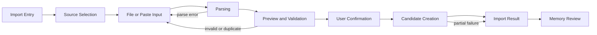

# Import UX Specification

Status: Implementation-grounded design  
Last updated: 2026-11-24

## 1. Purpose

Import is the bridge from user-owned material into NEXORA's governed Memory lifecycle. It is a primary knowledge workflow, not a backup utility and not a path to bypass confirmation.

## 2. Current implementation audit

### Supported input

- File picker accepts `.md`, `.markdown`, `.json` and `.txt`.
- The UI maps `.json` to JSON; every other accepted file is parsed as Markdown/plain text.
- Users may paste text directly.
- An optional source label is recorded; the fallback is `local-import`.
- There is no folder import, Obsidian Vault crawler, ZIP import, browser connector, drag-and-drop uploader or import history endpoint today.

### Parsing

- JSON accepts one object or an array of objects.
- JSON content may come from `content`, `text` or `body`; subject may come from `subject` or `title`.
- Markdown accepts `---`-delimited records with optional `type` and `subject` metadata.
- Plain text without a leading delimiter becomes one `note` item.
- Limits are 200,000 total characters, 100 items and 4,000 characters per item.

### Preview and validation

- `POST /api/v1/imports/preview` parses without writing.
- Every row is returned as `ready`, `duplicate` or `invalid` with a reason.
- Duplicate checks cover matching fingerprints and matching `(subject, type)` across Inbox and Confirmed.
- Empty content, overlong content and detected secrets are invalid.
- The UI preselects only ready rows and lets the user deselect them.

### Commit and lifecycle

- `POST /api/v1/imports` revalidates submitted items.
- Valid items are created through `profile.remember` in `30 Memory/Inbox`.
- Every created item remains a Candidate.
- Skipped rows return their type, subject and reason.
- Success offers “continue importing” and “go to Memory Review”.
- Confirmation remains exclusively in the existing Memory Review flow.

### Error and recovery reality

- Parse and commit errors are shown inline.
- Input content and source stay in component memory after an error.
- Preview can be reset and rerun.
- Current input is lost when the page/app closes; there is no import draft persistence.
- There is no durable import job, progress stream, retry token, partial-run identifier or import history.
- File read errors are not explicitly handled in the current component.

## 3. Product flow

“Source Selection” must describe only current capabilities: local file or pasted content. Obsidian may be shown as a source label/help example, not as a crawler integration.

## 4. Screen design

### 4.1 Entry and source

- Page title: Import personal knowledge / 导入个人知识.
- One-sentence lifecycle boundary: imported content becomes candidates and needs review.
- Two source modes: Local file and Paste text.
- Format choice: Markdown/plain text or JSON.
- Optional source label with an explanation of where it will appear.
- Primary action: Select file or continue to parsing.

### 4.2 Parsing

- Replace the action label with a calm “Parsing locally” state.
- Show selected file name, detected format and file size when available.
- Do not claim upload or cloud transfer; parsing occurs through the local app/API.
- Keep Cancel available while no commit has started.

### 4.3 Preview

- Summary row: total, ready, duplicate and invalid counts.
- Main list uses lightweight row separators, not nested cards.
- Each row shows type, subject, 200-character preview, status and reason.
- Only ready items are selectable.
- Primary action names the real effect: “Create N candidates”.
- Secondary action returns to input without losing the current content.

### 4.4 Result

- Show created and skipped counts separately.
- Skipped items remain visible with reasons.
- Primary next action is Memory Review.
- Continue Import resets only this page's input; it does not delete created candidates.

## 5. State matrix

| Stage | Loading | Empty | Error | Success | Recovery |
|---|---|---|---|---|---|
| Entry | Not required | No file/text selected | File read failed | Input available | Choose again or paste |
| Parsing | Parsing locally | No parsed items | API parse reason | Preview received | Edit input and retry |
| Preview | Validation pending | Zero ready items | Validation failed | Ready/duplicate/invalid classified | Return to input; retain content |
| Commit | Creating candidates | No selected ready items | Commit or partial item failure | Created/skipped result | Retry remaining ready items after re-preview |
| Result | Not required | Zero created with skipped reasons | Result unavailable | Candidate IDs returned | Continue import or open Memory Review |

## 6. Visual direction

- Use the shared midnight shell and a restrained violet ambient field behind the import workspace.
- A compact NEXORA Core motif may orient the entry state; it must not occupy every step.
- Use cyan for primary actions and selection, violet for ambient identity, and semantic colors for validation.
- Preview is a focused document workspace, not a dashboard grid.
- Avoid cloud-upload language, fake progress percentages and decorative analytics.

## 7. Implementation notes for the later coding phase

- Preserve `ImportPage`, `ApiClient.importPreview`, `ApiClient.importCommit` and both API routes.
- Phase 1A only restores Import to primary navigation and removes it from Backup tabs.
- Import visual/workflow polish belongs to a dedicated Phase 1D-Import slice.
- Durable drafts, import history, folder imports and true Obsidian ingestion require new product/API decisions and are out of current scope.

## 8. Acceptance criteria

- Import has a primary Knowledge navigation entry and keeps `#/import`.
- Markdown, JSON and accepted plain-text files behave exactly as the current parser supports.
- Preview writes nothing.
- Duplicate, invalid and ready states expose real backend reasons.
- Commit revalidates and creates candidates only.
- No imported item becomes Confirmed automatically.
- Result links directly to Memory Review.
- Failure does not silently clear the current input.
