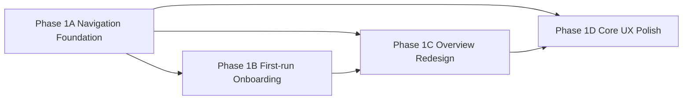

# Product Experience Phase Implementation Roadmap

Status: Proposed  
Last updated: 2026-11-23

## 1. Dependency map

Phase 1A establishes the shell and shared layout. Phase 1B and 1C reuse it. Phase 1D applies the patterns without rewriting business behaviour.

## 2. Phase 1A — Navigation Foundation

### Scope

- Primary navigation structure.
- App shell, page container and responsive drawer.
- Bottom Settings placement.
- Existing route-to-hub mapping.
- Shared page header and global state components.

### Non-goals

- Rewriting core page workflows.
- Deleting internal routes.
- Changing APIs.

### Exit criteria

- All existing capabilities remain reachable.
- Keyboard and mobile navigation pass.
- Shell tokens are shared by Onboarding and Workspace.
- No duplicate fixed status panel.

## 3. Phase 1B — First-run Onboarding

### Scope

- Five-step immersive setup.
- Current/new/historical Vault handling.
- Local storage and optional integration explanation.
- Candidate-only profile prompts.
- Vault-scoped interruption recovery.
- Completion summary and handoff.

### Dependencies

- Phase 1A shell primitives and responsive tokens.
- Existing Vault and onboarding APIs.

### Exit criteria

- New and existing Vault flows pass.
- Optional integrations can be skipped.
- Candidate content is never auto-confirmed.
- Interrupted setup resumes safely.
- Chinese, English, reduced motion and target viewports pass.

## 4. Phase 1C — Overview Redesign

### Scope

- Welcome and Vault identity.
- Next Best Action.
- Memory counts.
- Confirmed Profile progress.
- Recent supported activity.
- Factual System Health.
- Independent loading/error states.

### Dependencies

- Phase 1A shell.
- Phase 1B completion handoff and onboarding-state semantics.

### Exit criteria

- Five user questions are answered.
- All displayed data comes from current APIs.
- Partial failures are not shown as empty data.
- One primary action is visible.

## 5. Phase 1D — Core UX Polish

### Scope

- Memory, Profile, Reflection, Growth, Privacy, Backup and AI Connections.
- Shared state patterns, page headers and operation feedback.
- Cross-page next actions.
- Responsive and accessibility consistency.

### Dependencies

- Stable Phase 1A shell.
- Phase 1C state hierarchy and visual tokens.
- Existing domain tests remain authoritative.

### Exit criteria

- Each page meets the shared page contract.
- No business capability is removed.
- Empty, error, success and conflict states are verified.
- Domain regression tests pass.

## 6. Delivery sequence

| Order | Work package | Verification |
|---|---|---|
| 1 | Shell/navigation tokens | Navigation unit/E2E, 390px drawer |
| 2 | First-run state machine | Component tests |
| 3 | Vault and interruption recovery | Vault lifecycle regression |
| 4 | Profile candidate steps | Candidate/confirmation tests |
| 5 | Completion handoff | First-run E2E |
| 6 | Overview data orchestration | Partial-failure tests |
| 7 | Overview responsive UI | Screenshots at three widths |
| 8 | Core page shared patterns | Page-by-page regression |
| 9 | Accessibility and localisation | axe, keyboard, 200% zoom, zh/en |

## 7. Required evidence per phase

- Modified file list.
- Git diff.
- Typecheck, unit, build and relevant E2E results.
- Real runtime screenshots at 1440px, 1024px and 390px.
- Interaction recording for flows changed in that phase.
- Known issues and deferred work.
- Confirmation that no commit, push or merge occurred unless separately authorised.

## 8. Scope controls

- Phase 1B does not redesign Overview.
- Phase 1C does not rewrite Memory or Backup workflows.
- Phase 1D does not change Vault schema, permissions or confirmation semantics.
- Any missing API capability is reported as a dependency rather than replaced with demo data.

## 9. Confirmed product decisions

1. Privacy and Backup remain separate primary destinations.
2. First-run may finish with pending candidates; Overview then prioritises Memory Review.
3. Recovery stores the step, topic and optional integration preferences, but not an unsubmitted personal answer.
4. Backup attention is shown when no backup exists, no verification has succeeded, the latest successful verification is older than 30 days, or an operation failed.
5. Overview Recent Activity initially uses Memory Timeline only.
6. Settings remains fixed at the bottom of the sidebar.

Implementation begins with Phase 1A. Phase 1B starts only after the Navigation Foundation is reviewed and accepted.

## 10. Corrected phase plan after Import audit

### Phase 1A correction gate

The current Phase 1A workspace changes are preserved but are not accepted as final until:

- a Knowledge group is added;
- Import returns as an independent primary navigation item;
- Import is removed from Backup tabs;
- `#/import` remains directly addressable;
- Backup retains Backup & Recovery plus private GitHub Backup only;
- navigation tests cover the corrected four-group structure.

No additional business/API code is required for this correction.

### Phase sequence

| Phase | Product outcome | Explicit boundary |
|---|---|---|
| 1A | Corrected shell and full product navigation | No business workflow redesign |
| 1B | Five-step first-run experience | No Import expansion; no auto-confirmation |
| 1C | Overview as a real-state orientation surface | Does not replace primary pages |
| 1D-Memory | Memory and Profile experience polish | Preserve lifecycle and permissions |
| 1D-Import | Import entry, parsing, preview and result polish | Preserve current formats and API contract |
| 1D-Insight | Reflection and Growth polish | No invented scores |
| 1D-Control | AI Connections, Privacy, Backup and Settings polish | Preserve MCP/security/backup behaviour |

### Corrected implementation order

1. Revise planning documents and approve visual direction.
2. Correct Phase 1A navigation only after approval.
3. Re-run unit, navigation, accessibility and responsive tests.
4. Implement Phase 1B.
5. Implement Phase 1C.
6. Polish core pages in slices, beginning with Memory/Profile and Import.

### Import-specific test plan

- Markdown multi-record and plain-text single-record parsing.
- JSON object/array parsing and alternate content keys.
- 200,000-character, 100-item and 4,000-character limits.
- Empty, secret-bearing, duplicate fingerprint and duplicate subject/type rows.
- Preview creates no files.
- Commit revalidates and writes only Inbox candidates.
- Partial skips remain visible.
- Direct transition to Memory Review.
- File read failure, Chinese/English text, keyboard use and 390px layout.
