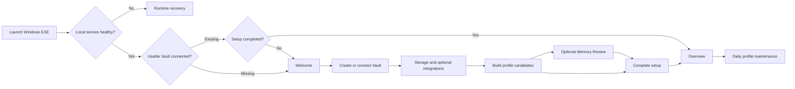
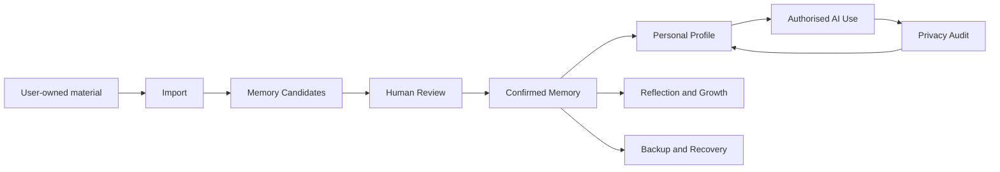

# NEXORA Product Experience Blueprint

Status: Proposed  
Scope: Phase 1A–1D product experience planning  
Last updated: 2026-11-23

## 1. Product position

NEXORA is a **local-first personal AI profile workspace**. It is neither a general AI chat product nor a generic knowledge base.

The product promise is:

1. The user owns the personal AI data stored in the local Vault.
2. The user continuously builds and maintains a confirmed personal profile.
3. New personal information enters a candidate state before human review.
4. AI clients receive only explicitly authorised context.
5. The user can inspect, export, back up, revoke and delete their data.

## 2. Experience principles

- **User language before system language.** Use “personal space”, “memory awaiting review” and “AI connection” before MCP, schema, scope or provider terminology.
- **Action before inventory.** Every page identifies the current state, primary action, result, recovery and next step.
- **Human confirmation is visible.** Candidate content never appears as confirmed profile data.
- **Local-first is concrete.** Show where data lives, which copies are optional and when content leaves the device.
- **Progressive disclosure.** Advanced controls remain available without occupying first-run or Overview.
- **One visual system.** Onboarding and Workspace share the same shell, colour, spacing, motion and state patterns.
- **Truthful state.** No demo counts, inferred security scores or fabricated completion percentages.

## 2.1 Confirmed product decisions

- Privacy and Backup remain separate primary destinations.
- First-run may complete with pending candidates; confirmation remains a later explicit user action.
- Interrupted setup restores the step, topic and optional integration preferences, but not an unsubmitted personal answer.
- Backup attention is driven by verified state: never backed up, never verified, verification older than 30 days, or an explicit failure.
- Overview Recent Activity initially uses Memory Timeline only.
- Settings is fixed at the bottom of the left navigation.

## 3. Experience architecture

The experience has four connected layers:

1. **Desktop runtime:** executable launch, local service, authentication token and runtime recovery.
2. **First-run setup:** Vault selection, local-first explanation, profile candidates and completion.
3. **Daily workspace:** Overview, Memory, Profile, Reflection and Growth.
4. **Control surfaces:** Privacy, Backup, AI Connections and Settings.

## 4. Visual direction

- Background: Midnight Navy / Deep Space.
- Primary interaction: Electric Cyan.
- Brand accent: restrained Violet.
- Surfaces: low-contrast blue glass panels with readable opaque fallbacks.
- Depth: fine borders and soft ambient glow, not continuous neon.
- Typography: modern sans serif, short headings and relaxed body spacing.
- Motion: opacity and transform only for primary transitions; all motion respects reduced-motion preferences.

The AI Core is the first-run brand anchor. After setup it becomes a quiet shell detail rather than a permanent decorative hero.

## 5. Core journey

## 6. First-run outcome

First-run is complete when:

- a valid Vault is connected;
- local storage ownership has been explained;
- optional integrations have been explicitly selected or skipped;
- profile questions have either produced candidates or been skipped;
- the user understands that candidates require review;
- the setup-complete marker is written only after the completion step.

First-run completion does not require Obsidian, GitHub, an MCP client, an AI Provider or reviewing every candidate. Pending candidates remain intact, and Overview prioritises Memory Review as the next best action.

## 7. Daily workspace outcome

Overview answers five questions:

1. What is the state of my profile?
2. Which memories need my review?
3. What changed recently?
4. Is my local data and access state healthy?
5. What should I do next?

Overview is an action-oriented summary, not a duplicate of every feature page.

## 8. Safety invariants

- Existing Vaults are validated before switching.
- No existing Vault is overwritten or reinitialised without explicit user action.
- Candidate creation never calls a confirmation endpoint.
- Tokens and credentials never enter URLs or persisted onboarding state.
- Reinstall detection prefers an existing registered Vault over creating a new one.
- Backup, permission, Vault identity and memory lifecycle behaviour remain authoritative.

## 9. Success measures

- A new user can reach a usable Overview without technical vocabulary.
- An existing user reaches their existing workspace without data migration.
- A user can explain where the primary data is stored and what is optional.
- A candidate can be traced from source through edit, confirmation or rejection.
- Every empty or error state presents a recovery action.
- The complete journey works at 1440px, 1024px and 390px without horizontal overflow.

## 10. Related specifications

- [USER_JOURNEY.md](USER_JOURNEY.md)
- [WORKSPACE_INFORMATION_ARCHITECTURE.md](WORKSPACE_INFORMATION_ARCHITECTURE.md)
- [OVERVIEW_DESIGN_SPEC.md](OVERVIEW_DESIGN_SPEC.md)
- [CORE_PAGE_UX_SPEC.md](CORE_PAGE_UX_SPEC.md)
- [UX_STATE_MATRIX.md](UX_STATE_MATRIX.md)
- [PHASE_IMPLEMENTATION_ROADMAP.md](PHASE_IMPLEMENTATION_ROADMAP.md)

## 9. Blueprint correction: continuing workspace

The product must support a repeating loop, not end at first-run or Overview:

Overview is the orientation surface for this loop. It does not replace Import, Memory, Profile, Reflection, Growth, AI Connections, Privacy, Backup or Settings.

### Corrected experience layers

1. **Ownership layer:** local Vault identity, current storage location and recovery boundaries.
2. **Knowledge intake layer:** independent Import entry, parsing, preview and candidate creation.
3. **Memory governance layer:** candidate review, confirmation, rejection and timeline.
4. **Personal intelligence layer:** Profile, Reflection and Growth built only from governed data.
5. **Controlled access layer:** AI Connections, Provider approval, Privacy audit and revocation.
6. **Protection layer:** local backup, private GitHub backup, verification and recovery.

## 10. Ten page design directions

| Page | Information hierarchy | Primary interaction | Visual character |
|---|---|---|---|
| Overview | Greeting and Vault identity → next action → memory/profile state → recent Memory Timeline → health | Continue the highest-priority real task | Editorial command surface with one dominant action, not a metric wall |
| Import | Lifecycle boundary → source/input → parsing → preview/validation → result | Create selected candidates | Focused ingestion workspace with subtle violet ambient field |
| Memory | Candidate queue → source/context → editable detail → lifecycle action → timeline | Confirm, edit or reject | Three-region review desk; status color is semantic, not decorative |
| Profile | Confirmed identity summary → category index → detail → access boundary | Inspect or edit confirmed context | Digital garden/library with structured sections and relationship cues |
| Reflection | Month and state → guided writing → events/goals → summary → history | Save current reflection | Calm long-form writing surface with restrained guidance |
| Growth | Current dimensions → evidence/history → goals → Human 3.0 trend | Inspect or record change | Longitudinal landscape; no decorative scores or fake precision |
| AI Connections | Connection state → client/provider list → scopes/approval → access record link | Authorise or configure | Trust-oriented connection workspace, explicit boundaries before credentials |
| Privacy | Active grants → recent audit → event detail → integrity/revocation | Inspect or revoke | Evidence timeline with high legibility and serious semantic states |
| Backup | Protection status → recommended action → snapshot history → verification/recovery | Create or verify backup | Recovery-first operational surface; GitHub connection is not success |
| Settings | General → Appearance → Language → Storage → Application | Save a preference | Quiet grouped form, visually subordinate to daily work |

### Visual system

- Midnight Navy is the continuous workspace base.
- Electric Cyan is the only primary interaction accent.
- Violet is ambient brand light and the NEXORA Core identity, not a border on every component.
- The AI Core appears at Welcome, selected empty/orientation states and key transitions only.
- Knowledge Space visuals are reserved for relationships, Profile and Memory context.
- Import uses document/file materiality; Memory uses queue/inspector materiality; Reflection uses writing materiality; Backup uses recovery history materiality.
- Real state always wins over decorative charts or invented activity.

## 11. Key screen concepts

These are design targets, not claims of implemented runtime UI and not sources of product data.

- [Corrected Overview concept](assets/overview-corrected-concept.png)
- [Import preview concept](assets/import-preview-concept.png)
- [Memory Review concept](assets/memory-review-concept.png)
