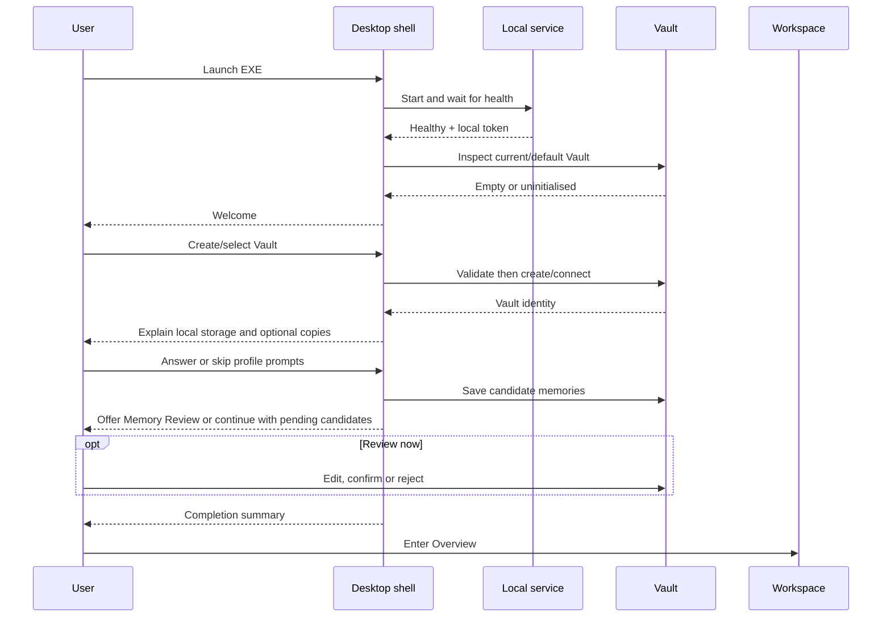
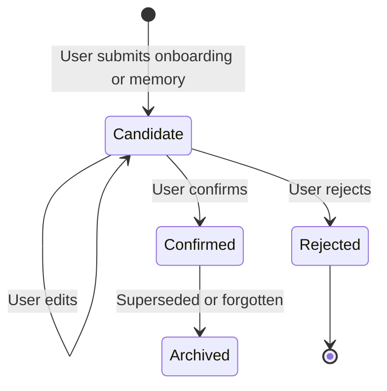
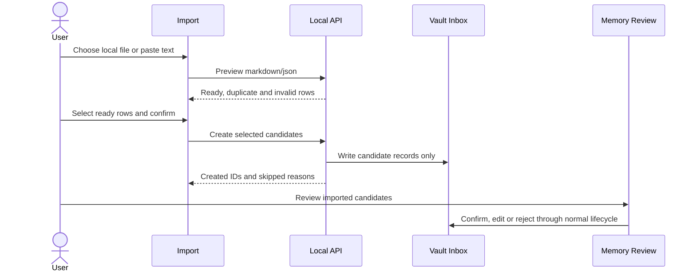

# NEXORA User Journey

Status: Proposed  
Last updated: 2026-11-23

## 1. Journey map

| Stage | User goal | Product response | Primary action | Evidence of success |
|---|---|---|---|---|
| Launch | Open the app | Start desktop shell and local service | Wait or retry | Health endpoint responds |
| Detect | Recover my existing state | Inspect runtime and current Vault | Continue | Valid Vault identity loaded |
| Welcome | Understand the product | Explain local ownership and confirmation | Start setup | User advances intentionally |
| Vault | Select where data lives | Recommend local location or registered Vault | Create/connect | Vault validates successfully |
| Storage | Understand copies and integrations | Explain Vault, Obsidian and GitHub | Continue or skip | Optional choices recorded |
| Profile | Begin personalisation | Ask one profile question at a time | Save candidate/skip | Candidate ID returned |
| Review | Control what becomes official | Show source, content and permissions | Confirm/edit/reject or review later | Lifecycle status changes or candidates remain pending |
| Complete | Know what happened | Summarise real Vault and memory state | Enter workspace | Setup marker written |
| Overview | Decide what to do next | Show state, activity and one recommendation | Follow next action | Target page opens |
| Maintain | Keep profile useful | Review, reflect, back up and manage access | Contextual action | Auditable state change |

## 2. New-user flow

## 3. Existing-user flow

1. Launch the executable.
2. Start the local service.
3. Resolve the last registered Vault.
4. Validate availability, schema and identity.
5. If setup was previously completed, open Overview directly.
6. If the Vault is valid but setup is incomplete, offer **Continue setup** and **Enter workspace**.
7. Never create, migrate or reset a Vault automatically.

## 4. Historical Vault flow

When registered Vaults exist:

- show display name and availability;
- avoid exposing the full Vault ID as the primary label;
- validate before connection;
- explain when connection requires a controlled restart;
- retain the current Vault until the user confirms the switch;
- provide “remove from recent spaces” separately from data deletion.

## 5. Reinstall flow

1. Start the application and scan only the existing registration mechanism.
2. If a registered Vault remains available, offer to reconnect it.
3. Preserve Vault identity, `binding.key`, backups and user content.
4. If registration is missing, allow the user to browse to an existing Vault.
5. Creating a new Vault is a separate explicit option.
6. Reinstall never treats an existing non-empty directory as a new Vault.

## 6. Candidate and confirmation flow

The UI must label Candidate content as “waiting for your review”. It must not contribute to confirmed Profile summaries until the user confirms it.

## 7. Exception journeys

### 7.1 Local service fails to start

- Show a dedicated desktop recovery screen.
- Display a human-readable cause and diagnostic location.
- Actions: Retry, open diagnostics, close application.
- Do not show the token gate or an empty workspace.

### 7.2 Vault does not exist

- Explain that the registered folder cannot be found.
- Actions: Locate Vault, use another registered Vault, create a new Vault.
- Removing the stale registration must not delete data.

### 7.3 Vault cannot be accessed

- Preserve the current registration.
- Explain whether the cause is permission, lock or invalid structure.
- Actions: Retry, select another Vault, open help.
- Never recreate the directory automatically.

### 7.4 Vault already exists

- Validate it as an existing Vault.
- If valid, offer Connect.
- If non-empty but invalid, refuse creation and explain why.
- Never overwrite files to satisfy the creation flow.

### 7.5 Setup is interrupted

- Restore the last safe step using Vault-scoped local UI state.
- Restore the current topic and optional integration preferences.
- Do not persist an unsubmitted personal answer.
- Do not persist tokens, credentials or path values in URLs.
- Offer Continue setup or Start over.
- Start over clears only onboarding UI state.

### 7.6 Candidate save fails

- Keep the user's draft visible.
- Show the specific recovery action.
- Retry must be idempotent where supported.
- Do not advance the step until a candidate ID is returned.

### 7.7 Existing user is misdetected as first-run

- Display the detected Vault name and confirmed content count.
- Offer Enter workspace as the safe default.
- Do not modify the Vault until the user explicitly continues setup.

## 8. Journey transition rules

| From | To | Trigger |
|---|---|---|
| Runtime recovery | Welcome/Overview | Local service becomes healthy |
| Welcome | Vault | User selects Start |
| Vault | Storage | Valid Vault identity is available |
| Storage | Profile | User continues or skips integrations |
| Profile | Review | At least one candidate exists and user chooses review now |
| Profile | Completion | Topics are answered/skipped and user continues with pending candidates |
| Review | Completion | User returns after reviewing |
| Completion | Overview | User completes setup |
| Overview | Any core page | Contextual action or navigation |

## 9. Accessibility and responsive checkpoints

- Focus enters each new step heading.
- Back returns focus to the originating control.
- Status is announced through polite live regions; errors use alerts.
- Step meaning is not communicated by colour alone.
- Motion is disabled or reduced under `prefers-reduced-motion`.
- At 390px, navigation, forms and actions use one column and 44–48px targets.

## 9. Import journey

### Import failure and recovery

| Failure | Current recoverable state | Designed response |
|---|---|---|
| File read failure | File can be selected again | Keep source choice, show file-level error and choose-again action |
| Parse failure | Pasted/file content remains while page is open | Show parser reason; return focus to editable input |
| Duplicate/invalid row | Preview reason from backend | Disable selection; allow input correction and re-preview |
| Commit partial skip | Created and skipped arrays | Keep result visible; send only created candidates to review |
| App closes before commit | No durable draft today | State clearly that uncommitted input is not saved |
| App closes after commit | Candidate files already exist | Re-enter through Memory Review; never repeat automatically |

## 10. Recurring use journeys

### Add knowledge

Import → Preview → Candidate creation → Memory Review → Profile/Timeline.

### Maintain memory

Memory Review → Source check → Edit → Confirm/Reject → Timeline → Profile.

### Use with AI

AI Connections → Authorise client/scopes → Provider approval where needed → Use → Privacy audit → Revoke.

### Protect data

Backup → Create snapshot → Verify → Optional private GitHub backup → Restore with safety backup.

### Existing user and reinstall

An existing or reinstalled user with a registered Vault enters the workspace without destructive onboarding. Import, Memory and Backup remain available immediately. NEXORA never replaces an existing Vault merely to complete setup.
