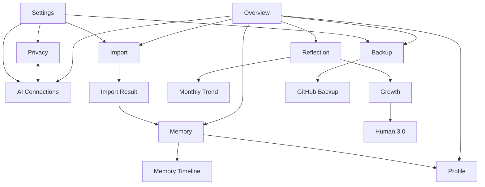

# Workspace Information Architecture

Status: Corrected proposal  
Last updated: 2026-11-24

## 1. Product structure

NEXORA is a continuing personal AI workspace, not an Overview-only dashboard. Navigation follows four intentions: work with personal knowledge, bring knowledge in, connect AI tools, and control the system.

```text
WORKSPACE
  Overview
  Memory
  Profile
  Reflection
  Growth

KNOWLEDGE
  Import

INTELLIGENCE
  AI Connections

SYSTEM
  Privacy
  Backup

BOTTOM
  Settings
```

Import is an independent primary destination. It is not part of Backup. Settings remains fixed at the bottom.

## 2. Capability mapping

| Primary destination | User task | Existing capabilities retained |
|---|---|---|
| Overview | Understand current state and choose the next action | Real Overview snapshot, next action, Memory Timeline activity, system health |
| Memory | Judge and manage personal memories | Memory Review, Memory Timeline, candidate lifecycle actions |
| Profile | Maintain confirmed personal context | Confirmed sections, access level, edit/delete entry points |
| Reflection | Record and review monthly reflection | Monthly Reflection, Monthly Trend |
| Growth | Observe long-term change | Growth Dashboard, Human 3.0 trend |
| Import | Bring user-controlled content into NEXORA | Markdown/JSON selection, parsing, validation, preview, candidate creation |
| AI Connections | Configure authorised AI access channels | MCP client registration/authorisation, Provider management |
| Privacy | Inspect and revoke access | Privacy Audit, security centre, client events, revocation |
| Backup | Protect and restore the Vault | Managed backup/recovery, private GitHub backup |
| Settings | Configure the application | Language, contrast, Vault summary, concept guide and existing settings |

## 3. Route preservation and merge map

| Existing entry/route | Correct destination | Presentation |
|---|---|---|
| `#/overview` | Overview | Primary item |
| `#/memory-review` | Memory | Default tab |
| `#/memory-timeline` | Memory | Secondary tab |
| `#/profile` | Profile | Primary item |
| `#/monthly-reflection` | Reflection | Default tab |
| `#/monthly-trend` | Reflection | Secondary tab |
| `#/growth-dashboard` | Growth | Default tab |
| `#/human-3` | Growth | Secondary tab |
| `#/import` | Import | Independent primary item |
| `#/ai-connections` | AI Connections | Default tab |
| `#/providers` | AI Connections | Secondary tab |
| `#/privacy-audit` | Privacy | Primary item |
| `#/backup-recovery` | Backup | Default tab |
| `#/github-backup` | Backup | Secondary tab |
| `#/data` | Backup | Legacy redirect/alias only |
| `#/settings` | Settings | Bottom item |

No route or capability is deleted. The shell may rename an entry for clarity while preserving its route.

## 4. Page graph



## 5. Page identity

Every page uses the same shell but not the same composition.

| Page | Distinct composition | Primary action |
|---|---|---|
| Overview | Editorial workspace summary with one dominant next action | Continue the most important task |
| Import | Guided ingestion pipeline with source/input, preview and result stages | Preview or import selected candidates |
| Memory | Review queue plus detail inspector | Confirm, edit or reject a candidate |
| Profile | Confirmed profile index plus category detail | Review or edit confirmed profile data |
| Reflection | Writing workspace plus month navigation | Save the current reflection |
| Growth | Longitudinal dimensions and history | Record or inspect a change |
| AI Connections | Client and provider permission workspace | Authorise/configure a connection |
| Privacy | Audit timeline and grants | Inspect or revoke access |
| Backup | Recovery-centred status and snapshot history | Create/verify a backup |
| Settings | Quiet form and grouped application preferences | Save a setting |

## 6. Shell hierarchy

1. Sidebar selects a primary product destination.
2. Top bar names the destination and exposes only global runtime actions.
3. Page header states current context and one primary action.
4. The main workspace uses a layout specific to the task.
5. Tabs expose retained historical Views only where they are the same user task.
6. Operation feedback stays near the action that produced it.

The shell must not repeat the same Vault or service state in four locations.

## 7. Responsive navigation

- At 1100px and above, keep the labelled sidebar.
- From 700px to 1099px, keep the shell readable and allow a compact drawer where content needs the width.
- Below 700px, use a modal drawer with focus trap, scrim, Escape close and focus restoration.
- Import progress remains visible without forcing a horizontal stepper.
- Secondary tabs may scroll; primary navigation does not.

## 8. Acceptance criteria

- Import is visible as a primary entry under Knowledge.
- Privacy and Backup remain independent.
- Settings remains visually separated at the bottom.
- Every existing capability is reachable in no more than two navigation decisions.
- Import success offers a direct transition to Memory Review.
- Deep links and legacy `View` routes keep working.
- Chinese and English labels describe the same information architecture.
